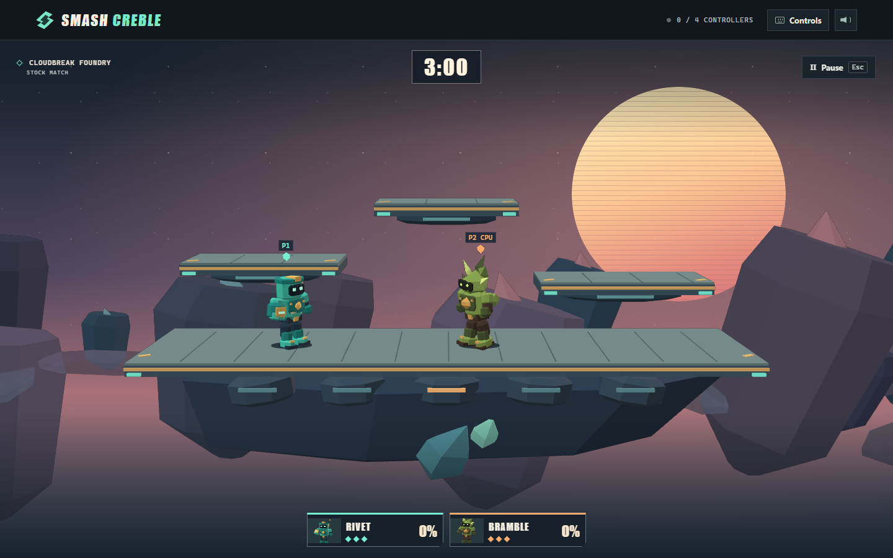
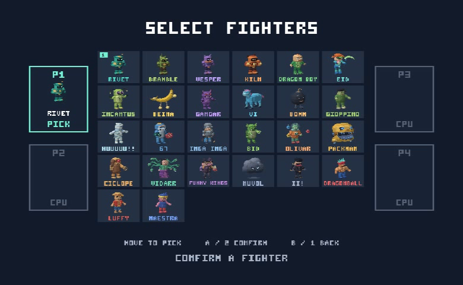

# Rift Ruckus

Rift Ruckus is a local platform fighter for desktop and mobile browsers. Combat takes place on a 2D plane in low-poly 3D arenas. The game features thirty-three fighters and synthesized sound effects.

## Screenshots

### Browser

### Wii (Dolphin)

See the [Wii build and play instructions](wii/README.md).

## Play on a phone

Open [Rift Ruckus on GitHub Pages](https://markod0925.github.io/SmashCreble/), then tap **Play match** and **Start fight**. Turn your phone sideways to play. The default **Touch / Keyboard** player faces a CPU.

- Use the analog stick to move and aim. Flick up to jump or down to drop through a raised platform. Use **Up + B** to recover.
- Press **A** for a light attack and **B** for a special. Superstar fighters can hold **B** for a charged special.
- Hold **Scudo** to shield, then tap **A** to dodge.
- Press **A + B** together to charge a heavy attack with a standard fighter or to use a collected Superstar with a Superstar fighter.

## Play on Windows

1. Install Node.js if it is missing. Double-click `Play.cmd` to start the local server and open the game in your default browser. You can also run `npm start` or `node server.mjs` in the project directory.
2. If the browser does not open automatically, visit the address printed in the launcher window in a browser with WebGL enabled. The server uses port `4173` by default and picks an available port if it is busy. Keep the launcher window open while you play. The game uses no external assets or packages.
3. Pick a fighter, select **Play match**, and select **Start fight**. The default setup is a keyboard player against a CPU. In the lobby, use the **Arena** button or press Up or Down on a joined controller to change the stage.

Pair Bluetooth controllers in Windows first, focus the game tab, then press the bottom face button or Start to join. Up to four controllers can play simultaneously. The first two controllers take over the default keyboard and CPU seats as they join. To play with both keyboard and controllers, use **Add keyboard** in the lobby. The game uses the browser’s [standard Gamepad mapping](https://www.w3.org/TR/gamepad/#remapping). A gamepad that the browser exposes without that mapping may need its Windows-compatible controller mode. Start begins the fight from the lobby and pauses during a match. The match pauses if a joined controller disconnects.

**Cloudbreak Foundry** has fixed platforms. **Stormcoil Array** has two lifts that carry fighters standing on them. The current visible between the pylons changes direction and pushes airborne fighters within it.

## Controls

| Action | Keyboard | Controller (Xbox labels) |
| --- | --- | --- |
| Move and aim | WASD or arrows | Left stick or D-pad |
| Jump and double jump | Space | A |
| Light attack | J | X |
| Charge and release heavy attack | K | Y |
| Fighter special | L | B |
| Upward recovery | Up + L | Up + B |
| Shield | Shift | LT or RT |
| Dodge while shielding | I | LB or RB |
| Drop through a raised platform | Down + Space | Down + A |
| Pause | Esc | Start |

Each fighter starts with three stocks. Damage makes subsequent hits launch a fighter farther. Cross a blast boundary and you lose a stock. The last fighter with a stock wins. At the three-minute limit, remaining stocks decide the result, then lower damage breaks a tie. Equal stocks and equal damage are a draw.

### Superstar fighter controls

Jump and double jump use Space or X. Hold Down with the jump button to drop through a raised platform.

| Dragon Boy | Eid | Incantus | Beina | Gangar | Vi | Bomm | Gioppino | Huuuuu!! | 67 | Inga inga | Bid | Olivar | Packman | Ciclope | Vidarr | Funny Kings | Nuvol | ii! | DragonBall | Luffy | Maestra | Nurofen Caps | Pinco Palino | Che Addominali! | Budino | SuperLibroGirl | Murena Man | HarriPotter | Keyboard | Controller (Xbox labels) |
| --- | --- | --- | --- | --- | --- | --- | --- | --- | --- | --- | --- | --- | --- | --- | --- | --- | --- | --- | --- | --- | --- | --- | --- | --- | --- | --- | --- | --- | --- | --- |
| Claw & Kick | Kick & Punch | Belly Bump | Kick & Punch | Punch & Kick | Horn Jab | Headbutts | Punch & Kicks | Slap | Kick & Headbutt | Headbutt | Claw Swipe | Kick & Punch | Chomp | Lasso Throw | Serpent Bites | Double Slap | Rain | Punch & Kicks | Bite | Kick & Punch | Hair Pull | Vitamin C | Headbutt | Jabs | Punch & Kick | Heel Kick | Snap Bite | Punch & Kick | J | A |
| Flame Breath | Pulse Shot | Ear Stench | Peel Flip | Lunge Bite | Hoof Kick | Quick Bomb | Zombie Bite | Choking Puff | Briefcase Swing | Draw & Slash | Flying Kicks | Sprout Blade | Gas Cloud | Club Smash | Flying Fangs | Tomato Toss | Hail Shower | Sword Thrust | Navel Beam | Headbutt | Ruler Strike | Mini Bomb | Flying Tongue | Triple Punch | 5K Blaster | Steel Sword | Flame Jet | Magic Bolt | Tap L | Tap B |
| Spine Shot | Blink Scythe | Stagger Hex | Banana Toss | Eye Lasers | Rainbow Arc | Power Steal | Brain Toss | Bandage Bind | 67 Venom Snakes | Lance Throw | Goblin Pair | Sprout Assault | Blue Eye Lasers | Gas Cloud | Serpent Coils | Blade Fan | Deep Freeze | Twin Slash | Clone Pair | Gum-Gum Punch | Sonic Shout | Mega Bomb | Bald Flash | Six-Punch Barrage | 20K Blaster | Mighty Slash | Blade Vortex | Magic Bombs | Hold L | Hold B |
| Scale Burst | Robot Spin | Hypnotic Chomp | Banana Barrage | Gulp & Spit | Clone Herd | Bomm Burst | Zombie Horde | Sarcophagus | Snake Dance | Blade Storm | Goblin Horde | Laser Burst | Trace 67 | Red Eye Beam | Frost Serpents | Royal Finale | Lightning Storm | Triple Blade Dive | Bacteria Burst | Rubber Dance | Mighty Shove | Clone Squad | Flying 67 | Acid Rain | 800-Round Reserve | Blinding Light | Atomic Salvo | Wand Lightning | J + L | A + B |

Touch the golden Superstar at center stage to stock one super attack. The star above the fighter and on the HUD shows when the move is ready. The Superstar returns after the move is used or its holder is knocked out. Upward recovery still uses Up + L or Up + B.

## Original roster

| Fighter | Role | Special |
| --- | --- | --- |
| Rivet | Scrap engineer | **Arc Bolt** fires an electric projectile. |
| Bramble | Root guardian | **Thorn Bloom** strikes on both sides. |
| Vesper | Rift courier | **Phase Dash** lunges forward and strikes nearby rivals. |
| Kiln | Furnace brawler | **Furnace Lift** jumps and launches nearby rivals. |
| Dragon Boy | Scaled striker | **Flame Breath** burns nearby rivals and **Spine Shot** launches back spines. **Scale Burst** sends scales in all directions. |
| Eid | Robot girl | **Pulse Shot** fires a blaster pulse and **Blink Scythe** teleports forward into a scythe strike. **Robot Spin** transforms Eid into an armored robot that fires and swings her scythe while spinning. |
| Incantus | Hypnotist | **Ear Stench** releases clouds from his ears. **Stagger Hex** slows affected rivals and briefly blocks their attacks. **Hypnotic Chomp** pulls an exposed rival toward Incantus, swallows them and spits them out. |
| Beina | Banana acrobat | **Peel Flip** opens her peel and tumbles vertically into nearby rivals. **Banana Toss** throws a spread of arcing bananas. **Banana Barrage** leaps and fires several volleys through the air. |
| Gangar | Fanged brute | **Lunge Bite** snaps at nearby rivals. **Eye Lasers** fire two beams straight ahead. **Gulp & Spit** grabs a nearby rival, swallows them, and spits them out. |
| Vi | Unicorn | **Hoof Kick** strikes with a forehoof and **Rainbow Arc** hits rivals along a rainbow. **Clone Herd** fills the herd to six half-size CPU copies with Vi’s attacks. A copy disappears on the first hit, when it falls out of the arena, or when Vi is eliminated. |
| Bomm | Walking bomb | **Headbutts** strike twice at close range. **Quick Bomb** lobs one bomb. **Power Steal** copies the secondary attack of the nearest rival in front for ten seconds of match time. A cloud flies from the rival to Bomm, then his fuse takes on the rival’s color. During the steal, a tap uses the copied attack. **Bomm Burst** blasts nearby rivals while Bomm keeps his stocks. He swells up after the blast, then shrinks and moves 35% slower for five seconds. |
| Gioppino | Zombie brawler | **Zombie Bite** turns a rival into a slower zombie for five seconds. **Brain Toss** throws a spread of cartoon brains. **Zombie Horde** fills the horde to six half-size CPU copies that use Gioppino’s attacks and disappear on their first hit. |
| Huuuuu!! | Mummy | **Slap** hits at close range. **Choking Puff** releases a cloud on both sides. **Bandage Bind** unwinds bandages from the mummy's body, wraps the first rival hit, and blocks their movement, jumps, shields, and attacks for five seconds. **Sarcophagus** seals a nearby rival in a coffin before dealing damage. |
| 67 | Radio shark | **Kick & Headbutt** chains two close-range hits. **Briefcase Swing** sends a tethered case out to midrange and reels it back. **67 Venom Snakes** releases green diamond-shaped serpents that damage and poison rivals for four seconds. **Snake Dance** plays a synth tune and locks all fighters in place for a seven-second dance while six snakes chase and bite 67's rivals. |
| Inga inga | Armored guard | **Headbutt** hits at close range. **Draw & Slash** unsheathes a sword and sweeps it in front of the guard. **Lance Throw** sends a lance straight ahead. **Blade Storm** sends two staggered volleys of spinning swords and daggers out in a full circle. |
| Bid | Goblin summoner | **Claw Swipe** scratches a nearby rival. **Flying Kicks** leaps into two kicks. **Goblin Pair** fills the group to two goblins and **Goblin Horde** fills it to five. These half-size CPU goblins use Bid's attacks in combat and disappear on the first hit, when they fall out of the arena, or when Bid is eliminated. |
| Olivar | Space explorer | Three small space sprouts orbit Olivar. **Sprout Blade** lines them up into a blade for two slashes. **Sprout Assault** enlarges them and sends them after the nearest opponent for five seconds, then they return and can form the blade again. **Laser Burst** fires a full circle of laser pulses. |
| Packman | Armored chomper | **Chomp** lunges into a bite. **Gas Cloud** hits nearby rivals. **Blue Eye Lasers** fires two beams straight ahead. **Trace 67** turns Packman blue and invulnerable while he snaps his jaw and flies along two strokes to draw a glowing 67 in the center of the arena. Rivals in the path of either stroke take damage. |
| Ciclope | One-eyed giant | **Lasso Throw** pulls the first rival it catches toward Ciclope and reels back. **Club Smash** strikes from overhead. **Gas Cloud** hits nearby rivals on either side. **Red Eye Beam** fires a single long-range laser from the red eye at the center of his face. |
| Vidarr | Frost gorgon | **Serpent Bites** snaps at a nearby rival. **Flying Fangs** launches detached snake heads. **Serpent Coils** sends out snakes that bite and knock back a rival. **Frost Serpents** freezes every opponent in place for five seconds, then stretches Vidarr's snake hair across the arena to bite them. |
| Funny Kings | Two-faced royalty | **Double Slap** hits twice with the glove. **Tomato Toss** splatters a tomato on impact. **Blade Fan** fires a midrange spread of blades. **Royal Finale** launches blades and explosive hand bombs in a full circle. |
| Nuvol | Storm cloud | Can jump three times in midair. **Rain** showers nearby rivals and reaches below Nuvol. **Hail Shower** drops chunks of hail straight down. **Deep Freeze** fires an ice projectile that immobilizes the first rival hit for five seconds. **Lightning Storm** marks columns and then strikes them in three waves. A direct hit briefly reveals a stylized skeleton. |
| ii! | Three-sword duelist | **Punch & Kicks** chains a punch and two kicks. **Sword Thrust** lunges with one blade. **Twin Slash** draws two swords for two strikes. **Triple Blade Dive** launches ii! into the air and brings all three blades down together. |
| DragonBall | Muscle brawler | **Bite** lunges and snaps at a nearby rival. **Navel Beam** fires a straight laser from his belly button. **Clone Pair** refills the group to two half-size fighters that attack on their own and vanish on the first hit. **Bacteria Burst** launches a fan of brown, rod-shaped projectiles. |
| Luffy | Rubber brawler | **Kick & Punch** chains two close-range strikes. **Headbutt** lunges forward. **Gum-Gum Punch** stretches his arms for a long-range blow. **Rubber Dance** transforms Luffy into his white form and freezes every rival for three seconds as he dances and strikes them with elastic punches and kicks. |
| Maestra | Sonic teacher | **Hair Pull** tugs a nearby rival toward Maestra. **Ruler Strike** swings a wooden ruler overhead. **Sonic Shout** sends visible sound waves forward that hit rivals as they reach them. **Mighty Shove** drives nearby rivals away with a strong two-handed push. |
| Nurofen Caps | Capsule caster | **Vitamin C** shoots a tablet forward. **Mini Bomb** lobs a small bomb. **Mega Bomb** throws a bigger bomb with a wider blast. **Clone Squad** brings the group to four half-size CPU clones. They use explosive slaps and vanish on the first hit they take. |
| Pinco Palino | Flying kicker | **Headbutt** lunges into a nearby rival. **Flying Tongue** lashes at medium range. **Bald Flash** dazzles nearby rivals and briefly blocks their attacks. **Flying 67** launches from Pinco Palino’s current position. He kicks through opponents while painting a green 67 in the air. |
| Che Addominali! | Heavyweight boxer | **Jabs** chains two punches. **Triple Punch** strikes with three punches at once. **Six-Punch Barrage** follows up with six separate punches. **Acid Rain** showers an area for five seconds, damaging opponents who stay underneath. |
| Budino | Jelly blaster | **Punch & Kick** chains a jab and a kick. **5K Blaster** fires a quick teal pulse. **20K Blaster** fires a larger, harder-hitting gold pulse. **800-Round Reserve** fills Budino’s reserve to 800. The blasters use 40 and 80 rounds, respectively, for wider bursts while the reserve lasts. The reserve resets when Budino loses a stock. |
| SuperLibroGirl | Spellbook knight | **Heel Kick** strikes with her blue heel. **Steel Sword** swings her pink blade. **Mighty Slash** deals more damage and launches rivals farther. **Blinding Light** opens the book and dazes every rival in the arena for three seconds, blocking their controls. |
| Murena Man | Moray blades | **Snap Bite** lunges and snaps his jaws. **Flame Jet** breathes fire forward. **Blade Vortex** spins both arm blades for three hits and launches nearby rivals on the last sweep. **Atomic Salvo** tosses three bombs in a spread. |
| HarriPotter | Wand caster | **Punch & Kick** strings a jab into a kick. **Magic Bolt** fires a spell from the wand. **Magic Bombs** hurls three translucent bombs that explode on impact. **Wand Lightning** sends a branch of lightning from the wand to every active rival across the arena. |

## Code layout

- `src/main.js` connects the main menu, lobby, and match loop.
- `src/fighters/<fighter-id>/profile.js` contains a fighter's stats, move definitions, and projectile launch behavior. The adjacent `model.js` contains their 3D rig, animations, and move visuals. Rivet, Bramble, Vesper, and Kiln share a rig builder and animation code in `src/fighters/standard-model.js`.
- `src/combat/` handles the match clock, stocks, movement, attacks, hit resolution, projectiles, and CPU controls.
- `src/arenas/index.js` defines platform layouts and motion, blast boundaries, spawn points, and environmental effects. `src/combat/arena.js` keeps the platform positions and environment for each match.
- `src/render/` contains the WebGL renderer, geometry, arena, cameras, and effects. The roster portraits and match use the same fighter models.
- `src/ui/` contains the roster, lobby, dialogs, and HUD. Keyboard and controller input live in `src/input.js`, and synthesized effects live in `src/audio.js`.

To add a fighter, create a folder with a profile and a model. Register the profile in `src/fighters/index.js` and the model in `src/render/characters.js`. The roster, portraits, and lobby read from those registries. Update the roster copy and control guide in `index.html` when adding a fighter.

To add an arena, register a definition in `src/arenas/index.js`. Mark solid floors with `main`. Other platforms allow fighters to drop through them. Each spawn uses a platform ID and a horizontal offset from that platform's center. The respawn height is relative to the same platform. A definition can set its own Superstar position and camera.

An optional `environment(elapsed)` returns state for the current simulation step. A platform's `motion(environment, elapsed)` returns horizontal and vertical offsets from its layout. An optional `airDrift(position, environment)` receives an airborne fighter's body center and returns horizontal drift in units per second. These hooks run on the simulation clock, which stops during the countdown, pauses, and Snake Dance. To add a visual theme, register its drawing functions in `src/render/arena.js` and give the arena definition the same theme name. The renderer reads the same platform positions and environmental state as combat.
